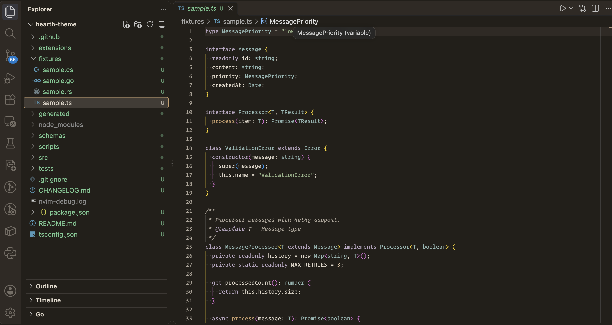
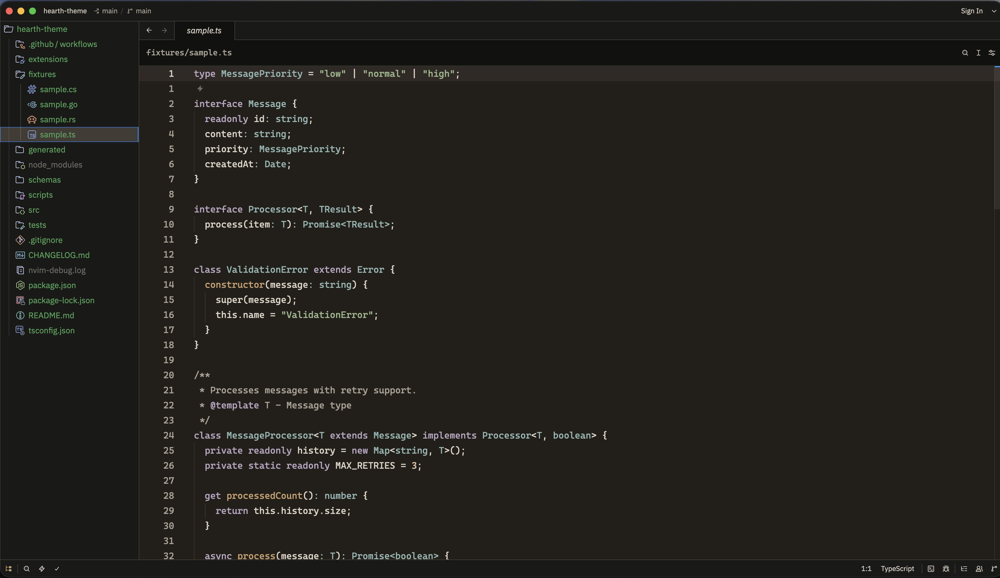
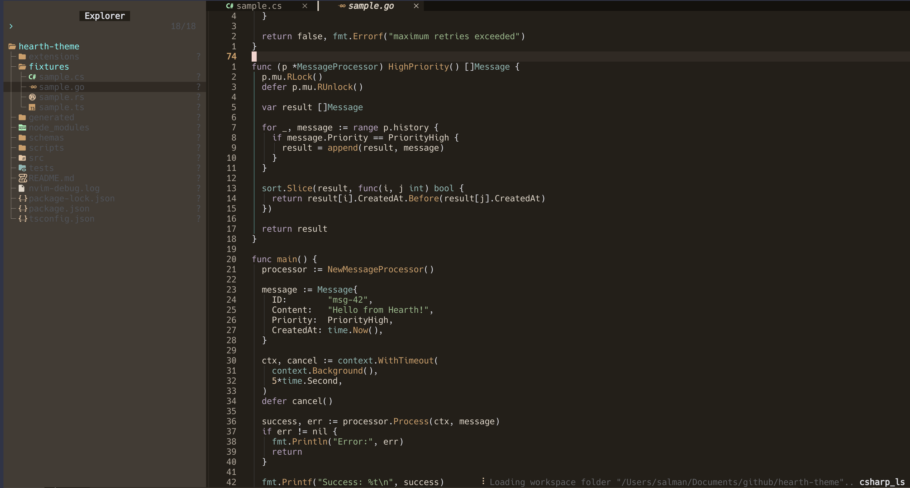

# Hearth Theme

A warm, organic color theme for developers.

Hearth uses a shared OKLCH color system to provide
consistent syntax highlighting and UI colors across editors.

## Screenshots

Experience Hearth's warm, carefully crafted color palette across
Visual Studio Code, Zed, and Neovim.

### Visual Studio Code

### Zed Editor

### Neovim

---

All three editors share the same semantic color system, ensuring
a consistent visual experience across your development environment.

## Features

- Perceptually designed OKLCH color palette
- Shared semantic design tokens
- Syntax highlighting for multiple languages
- Consistent terminal ANSI colors
- Automated contrast and theme validation

## Development

Install dependencies:

    npm ci

Generate all themes:

    npm run generate

Run quality checks:

    npm run verify

Package the VS Code extension:

    npm run package:vscode

## Architecture

    Color Ramps
        ↓
    Color Registry
        ↓
    Semantic Tokens
        ↓
    Theme Resolver
        ↓
    Editor Adapters

## License

See LICENSE.

